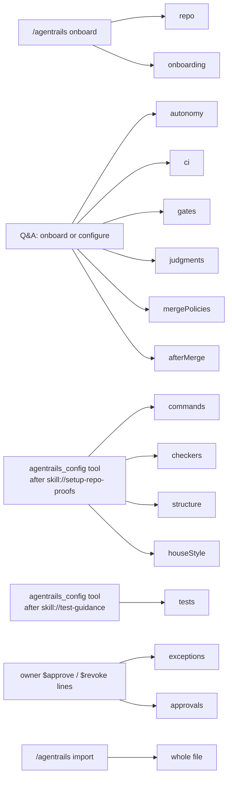

# Agent-rails config contract

Each repository's rails settings live in one file in its main checkout:
`.agentrails/config.json`. The repository never commits it, and it names no omp path.
[validator.py](../engine/guardrails/context/config/validator.py) is the only validator;
`guardrails config-check` runs it, and the TypeScript rails call that command.

- Every object is strict: an unknown key at any depth is refused.
- Malformed JSON, a duplicate key or a missing section is refused. There are no defaults
  for required keys and no older shapes.
- `repo.slug` must equal the lowercase `owner/name` of the clone's GitHub origin.
- A missing or refused file sends the repository to onboarding.

## Sections and writers

Each section has exactly one writer. Agent tools never write the file: the rails refuse every
edit, write, eval or shell write to a path with a `.agentrails` segment.



| Section | Writer | Holds |
| --- | --- | --- |
| `schemaVersion` | Every writer | `1` |
| `repo` | `/agentrails onboard` | `slug`, `defaultBranch` |
| `onboarding` | `/agentrails onboard` | Completion time, Q&A version, skill stamps |
| `autonomy` | Q&A | `branch`, `pr`, `merge`: `allowed` or `ask` |
| `ci` | Q&A | Whether merges need CI; runner role and required context |
| `gates` | Q&A | Which deterministic gates run; code rules switched off |
| `judgments` | Q&A | Per-question overrides of the global judgment mode |
| `mergePolicies` | Q&A | Merge method and proof per base and head prefix |
| `afterMerge` | Q&A | Optional command required after a merge |
| `commands` | Setup tool | Repo commands as argv arrays |
| `checkers` | Setup tool | One settings object per engine checker |
| `structure` | Setup tool | Owners, tiers, import direction, ownership areas |
| `houseStyle` | Setup tool | The engine house-style `version` |
| `tests` | Test tool | The test settings: tiers, adapters, budgets, coverage and more |
| `exceptions` | Owner lines | Approved rule suppressions by path |
| `approvals` | Owner lines | Approved budgets, ratchets, skips and exemptions |

Writer rules:

1. The Q&A runs only in an owner slash command with an interactive UI.
2. The setup tool records a section only after this session read the named skill. It merges into
   the onboarding draft; on an onboarded repository it needs the owner's confirmation.
3. The tool carries skill stamps in the draft; only `/agentrails onboard` writes `onboarding`.
4. `$approve` and `$revoke` lines count only in a prompt the owner typed in the main session.
   Injected prompts and subagent prompts never write the config.
5. Every write validates the whole file first and replaces it atomically.

[config-template.json](../engine/data/config-template.json) is the template for the
setup and test sections.

## Onboarding and the owner commands

`/agentrails` is an owner slash command; agents cannot run it. Subcommands that prompt need an
interactive omp session.

| Subcommand | Does |
| --- | --- |
| `onboard` | Starts onboarding, or runs the Q&A once the draft holds every setup section |
| `configure` | Re-runs the Q&A on a valid config and rewrites only the Q&A sections |
| `export <file>` | Writes the valid config to a new file outside every Git work tree |
| `import <file>` | Validates the file against the origin, then writes it |
| `status` | Shows the config state, its problems, the onboarding state and the draft |

Onboarding runs in three steps:

1. `/agentrails onboard` excludes `/.agentrails/` and `/.proofs/`, marks the repository as
   onboarding for the session and sends the agent a fixed instruction. The agent runs
   skill://setup-repo-proofs and skill://test-guidance.
2. The agent records each setup section with the `agentrails_config` tool. A section is refused
   until the session read its skill, and the engine checks it with `config-check --section`.
   The draft at `<git common dir>/agentrails/draft.json` holds the sections and each skill's
   stamp: a sha256 of the bundled skill folder, the run time and the scope.
3. The second `/agentrails onboard` runs the Q&A, writes the whole config and deletes the draft.
   When the repository ships `.githooks/`, it asks the owner to set `core.hooksPath`.

The Q&A is fixed in [questionnaire.ts](../lib/questionnaire.ts), version 1. It never offers
`in-scope/ask_first` or `dependency-severity/impact`, and it does not ask for `gates.audit`.
`config-check --list-rules` and `--list-questions` give the rule and judgment choices.
`/agentrails configure` also repairs a config refused only for an older questionnaire version.

## The imported skills

`skills/setup-repo-proofs` is the upstream skill from `xSolutions365/skills`
(`plugins/setup-repo-proofs`), copied verbatim at commit `7137100`. Only `hide` and
`disable-model-invocation` are added to its frontmatter. The quality gates neither format nor lint
it; `IMPORTED_SKILLS` in `tests/test_skill_references.py` lists it.

It differs from the rails in three known ways:

1. Rule catalogue. The engine catalogue, `engine/data/guardrail-rules.json` (172
   rules), is the only rule authority for the rails, `gates.rules` and `config-check
   --list-rules`. The skill's `assets/guardrail-rules.json` (164 rules) is the target
   repository's own catalogue, and no rails code reads it. The IDs drift: the engine's
   `TEST.fast-tier-isolation` and `TEST.budget.fast-tier-time` are the skill's
   `TEST.t1-isolation` and `TEST.budget.t1-time`. Only the skill has `GATE.enforced`,
   `GATE.parity`, `GATE.self-check` and `GIT.required-checks`.
2. Host protection. The skill's `GIT.required-checks` makes the host require the CI and
   validator statuses. The rails never require host protection: a merge needs a CI status only
   when `ci.enabled` is true.
3. Run state and hooks. The skill appends `/.proofs/` to `.git/info/exclude` and runs
   `git config core.hooksPath .githooks`. Under the rails the extension writes the exclude line,
   and `/agentrails onboard` offers the hooks path to the owner.

`skills/test-guidance` is the upstream skill from `xSolutions365/skills`
(`plugins/test-guidance`), copied verbatim at commit `7137100` in the same way; `IMPORTED_SKILLS`
lists it too. It analyses the repository's tests and, after the owner signs its plan, installs a
testing skill in the repository (by default `.agents/skills/testing-approach/`) that agents follow at
task time. It installs no hook, CI job or checker and writes no rails config: the agent translates
its output into the `tests` section (see [Tests](#tests)). The test rules' guidance lives in their
catalogue remediation, which every finding prints.

## Rails scope

The rails decide what runs in a repository from its config state, on every action.
There is one governed state, with no mode switch.

| Scope | When | What runs |
| --- | --- | --- |
| Outside | No Git repository, or no GitHub origin | Fixed guards only |
| Unresolved | Git or the engine cannot resolve the config | Git and gh writes refused |
| Not onboarded | Missing or invalid config, no onboarding this session | Onboarding refusal |
| Onboarding | The owner ran `/agentrails onboard` this session | Fixed guards; no merge |
| Governed | A config the engine accepted | Every rail, as `gates` and `autonomy` say |

The onboarding refusal (`onboarding-required`, or `config-invalid` with the engine's problems)
applies to:

- edit and write tools on paths inside the repository;
- `git commit`, `git push`, `gh pr create` and `gh pr merge`, after their fixed guards;
- `askFirst` commands.

Reads, other commands, the `agentrails_config` tool and the `handoff` tool still run.

While a repository is onboarding, edits, commits, pushes of non-default branches and
`gh pr create` run under the fixed guards. Commit checks, path checks and the
judged commit rails wait for the config. `gh pr merge` is refused (`onboarding-merge`): the
owner merges the bootstrap PR. Agents never write `.git/info/exclude`: the extension excludes
`/.agentrails/` and `/.proofs/`. An agent may set `core.hooksPath` only to a directory inside
the repository, such as `.githooks`; `/agentrails onboard` also offers it to the owner.

`in-scope/ask_first` runs in every Git repository, whatever its config state.

While a repository is onboarding, `$approve` and `$revoke` lines write the draft's
`exceptions` and `approvals`, so budgets and exemptions can be approved before the config exists.
`approvedBy` is the login `gh api user` returns, read once per session.

## Commands

`commands.commit` is required; `ci`, `audit` and `format` are optional.
Every command is an argv array of non-blank strings, never a shell string, and names the
repository's own tools. `commit` runs the static checks, all T1 tests and the affected T2 tests.
`ci` runs the full T1 and T2 suite. `format` is the formatter `freeze()` runs before hashing.
`audit` is the dependency audit.

## Autonomy

| Key | Action | `ask` means |
| --- | --- | --- |
| `branch` | Push a non-default branch | Refused until `$approve autonomy:branch:<branch>` |
| `pr` | `gh pr create` | Refused until `$approve autonomy:pr:<branch>` |
| `merge` | `gh pr merge` | Refused until `$approve autonomy:merge:<pr number>` |

An approval line grants one use in the session. Local branches and worktrees are always allowed.
A push to the default branch is always refused.

## CI

`ci.enabled: false` means a merge needs no CI status; prove and structure review still apply
as `gates` say. `ci.enabled: true` needs `runner` and `requiredContext`: that context must be
`success` on the PR's exact head, as a commit status or check run, whoever posts it.

The runner is a role, not a host. Each device's `~/.omp/ci-runners.json` maps the role to
submit, wait, status and logs commands, and `scripts/ci_runner.py` runs them.

| Runner | Who runs `commands.ci` | Needs |
| --- | --- | --- |
| `github-actions` | An Actions job named for the context, on every push | The repo workflow |
| `ci-gate` | `scripts/ci_gate.py` on the NUC, on the exact SHA | `commands.ci`, allowlist entry |

A `ci-gate` repository is listed in `scripts/ci-gate-repos.json` and has a
`.devcontainer/devcontainer.json` with `build.dockerfile` or `image`. The NUC reads its own copy
of the config (see [Export and import](#export-and-import)). It refuses a config whose `ci` is
not enabled with runner `ci-gate`.

## Gates

| Gate | When on |
| --- | --- |
| `commitChecks` | Before `git commit`: `commands.commit`, then `guardrails check` |
| `pathCheck` | Path-check after edits, on the staged paths at commit, and at handoff |
| `prove` | A merge needs a watched `prove()` pass, when the merge policy's `proof` is true |
| `structureReview` | A merge needs a watched `structure_review()`, when `proof` is true |
| `audit` | `ci_gate.py` runs `commands.audit` with network before the offline gate |
| `rules` | `{<rule id>: false}` drops that code rule's findings; a missing rule is on |

`gates.audit` is true exactly when `commands.audit` exists. Dependency triage of the
audit lines in `commands.commit` output runs whatever `gates.audit` says.
Commit scope, commit-alone and hook-bypass refusals are fixed and cannot be turned off.

## Merge policies

Each entry is `{base, headPrefix, method, proof}`. The rails use the first entry whose `base`
equals the PR's base branch and whose `headPrefix` starts its head branch.

| Field | Values |
| --- | --- |
| `base` | Base branch name |
| `headPrefix` | Head branch prefix; `""` matches every head |
| `method` | `rebase` or `merge`: the one `gh pr merge` flag accepted |
| `proof` | `true` asks for prove and structure review, as `gates` allow |

The list may be empty. No match means `{method: "rebase", proof: true}`. The rails always
refuse `--admin`, and no policy waives CI.

## After merge

`afterMerge.argv` is a repo command the rails require after a merge. With `paths` (globs), only a
merge whose PR files match one glob requires it. Until a run exits 0, the session's turn-end
obligations name it.

## Judgments

`judgments` lists overrides only, keyed `<judgment>/<question>`. A missing key follows the
global mode in `judgments/<judgment>/thresholds.json`.

- The effective mode is the lower of the global mode and the override, with
  off < shadow < enforced. An off question makes no judge call and writes no row.
- `enforced` is refused when the global mode is `shadow`: only measurement promotes.
- `shadow` is refused for a question that cannot run in shadow.
- `in-scope/ask_first` and `dependency-severity/impact` cannot be configured.

## Tests

`tests` holds the test settings. Its keys are `tiers`, `adapters`, `public_entry_points`,
`run_events`, `fast_tier_budget`, `coverage`, `guards`, `environments`,
`verification_surface`, `identity_artefacts`, `layout` and `command_notes`.

- `tiers.<tier>` holds only the `command` that runs every framework in the tier.
- `adapters` has one entry per test framework (`pytest`, `vitest`, `bun_test`, `go`). Each
  gives a native `selector` and `location` for every tier it takes part in.
- `public_entry_points` maps each owned package to its public entry point as
  `"<package>": "<module>:<symbol>"`, for example `{"ledger": "ledger.cli:main"}`. The package
  is a Python package name, a folder or a package.json `name`; the adapters treat code inside it
  as owned. The module is named as its language imports it: a dotted Python module, a TypeScript
  file path or package name, or a Go import path. The symbol is a top-level name that
  `TEST.no-test-hooks` never reports as used only by tests. Every other form is refused.
- `fast_tier_budget.machines[]` entries are keyed by the `id` the budget probe reports.
- `tiers.t3`, `verification_surface`, `identity_artefacts` and
  `run_events.nightly_scheduler` may be `{"none": true}`. Each such exemption needs an
  `exemption` approval; an exempt T3 has no adapter tier.
- Approval text never sits in `tests`: it lives in `approvals`.

skill://test-guidance writes no config. The agent translates its output into `tests`:

| test-guidance output | `tests` keys |
| --- | --- |
| Tier map lines | `tiers.<tier>.command`, each adapter's `selector` and `location` |
| Tier budgets and deferrals | `fast_tier_budget`; the owner approves each machine's budget |
| Commands and checks (local, merge, scheduled) | `run_events`, `command_notes` |
| Public entry points | `public_entry_points` |
| Layout, fixtures and support | `layout` |
| Coverage floors | `coverage` |
| Boundary launch and required environments | `environments` |
| Isolation (HOME, XDG, process and network guards) | `guards` |

`verification_surface` and `identity_artefacts` have no test-guidance output: record the
repository's values, or `{"none": true}` with an owner `exemption` approval. Each mechanism gap
the skill reports (a tier with no complete command, an unselected test file) goes to the owner.

## Checkers

`checkers.<checker>` holds one engine checker's settings, for example `checkers.check`,
`checkers.naming` and `checkers.python`. Each checker module's docstring lists its settings and
defaults; defaults grant nothing.

- `checkers.check.run` selects whole-repo steps by name; an unknown name is refused.
- `checkers.check.exclude` lists generated, vendored and fixture paths.
- Ratchet approvals and test skips are refused here; they live in `approvals`.

## Exceptions

Each entry is `{rule, path, check?, reason, approvedBy, approvedAt}`, unique on
`(rule, path, check)`.

- `rule` is a catalogue rule id, or a `structure-naming/<question>` judgment rule.
- `path` is a glob matched with `fnmatchcase`. A plain path matches itself and its descendants.
- `check` limits the suppression to one sub-check of the rule, such as
  `child-repeats-parent` in `NAME.conventions`. Without it the whole rule is suppressed there.
- The owner writes an entry with
  `$approve exception <RULE> <path-glob> [check=<check>] -- <reason>` and removes it with
  `$revoke exception <RULE> <path-glob> [check=<check>]`.

## Approvals

Each entry is `{kind, target, reason, approvedBy, approvedAt}`, unique on `(kind, target)`.
Every entry must point at something that exists.

| Kind | Target |
| --- | --- |
| `budget` | A `tests.fast_tier_budget.machines[].id`; every machine needs one |
| `ratchet` | A coverage-ratchet path |
| `skip` | A skipped test id |
| `exemption` | One of the four exemptable `tests` fields set to `{"none": true}` |

The owner writes them with `$approve approval <kind> <target> -- <reason>` and removes them
with `$revoke approval <kind> <target>`. `approvedBy` is the owner's GitHub login.

## Worktrees and exclusion

The file lives in the main checkout: the parent of the Git common directory. A linked worktree
reads its main checkout's file, so every worktree of a repository shares one config. A bare
repository or a separate git dir has no main checkout and cannot be configured.

The extension keeps the folder out of git through `<git-common-dir>/info/exclude`, which every
worktree reads. It adds `/.agentrails/` on every write, and `/.proofs/` for the proof
workflow. The engine never scans `.agentrails/` or `.proofs/`.

## Export and import

| Command | Does |
| --- | --- |
| `/agentrails export <file>` | Writes the validated config to a file outside every Git work tree |
| `/agentrails import <file>` | Validates the file against the origin, then writes it |
| `ci_gate.py config-import <file>` | Installs an exported file on the NUC |

`/agentrails import` asks the owner before it replaces an existing config.
`ci_gate.py config-import` validates the file, checks that `repo.slug` is in
`scripts/ci-gate-repos.json` and writes it atomically to
`<XDG_DATA_HOME or ~/.local/share>/ci-gate/configs/<owner>/<name>/config.json`.
Run it on the NUC after every change to a `ci-gate` repository's config.

## oh-mi-pi-config example

This repository's config routes CI to the NUC and merges NUC syncs without proof:

```json
{
  "ci": { "enabled": true, "runner": "ci-gate", "requiredContext": "gate" },
  "mergePolicies": [
    { "base": "nuc-config", "headPrefix": "agent/nuc-sync-", "method": "merge", "proof": false }
  ]
}
```

| Fact | Enforced by |
| --- | --- |
| `nuc-config` sync: PR from `agent/nuc-sync-<date>`, `--merge`, no proof | `mergePolicies` |
| Every other PR rebases with proof | Default policy |
| `gate` must be green on the exact head | `ci` |
| `ci-gate` is `scripts/ci_gate.py` on the NUC | `~/.omp/ci-runners.json` |
| A missing `scripts/ci-gate-repos.json` entry needs a setup PR, never a CI waiver | Not enforced |
| A passing `ci-quality-gates.yml` run never replaces a missing `gate` | Not enforced |
